  

  I build scalable AI products, reliable APIs, and automated workflows.

  <a href="https://adamamzar.my">Portfolio</a>&nbsp;&nbsp;·&nbsp;&nbsp;
  <a href="https://linkedin.com/in/adamamzar">LinkedIn</a>&nbsp;&nbsp;·&nbsp;&nbsp;
  <a href="mailto:adamnajmin15@gmail.com">Email</a>&nbsp;&nbsp;·&nbsp;&nbsp;
  <a href="https://leetcode.com/adamamzar">LeetCode</a>

---

## About Me

- Pursuing a **B.Sc. (Hons.) in Computer Science** at **UiTM**.
- Building practical AI systems through my experience at **Gamuda Engineering**.
- Technical Lead for **TenderVise AI**, an automated tendering and bid-management system powered by RAG pipelines and vector databases.
- Creator of **Abang Mystery**, an autonomous AI testing architecture.
- Currently focused on advanced **Retrieval-Augmented Generation**, **MongoDB Atlas**, and scalable API design.
- I enjoy turning ambitious AI ideas into dependable products people can actually use.

---

## Tech Stack

- **Languages:** Python, JavaScript, TypeScript
- **Backend:** FastAPI, Node.js
- **Frontend:** React
- **Data:** MongoDB Atlas, Firebase, vector databases
- **AI:** Gemini, RAG pipelines, n8n
- **Tools:** Git, GitHub

---

  

---

## GitHub Analytics

  
  

  

---

## LeetCode

  <a href="https://leetcode.com/adamamzar">
    <picture>
      <source media="(prefers-color-scheme: dark)" srcset="https://leetcard.jacoblin.cool/adamamzar?theme=dark&ext=activity" />
      <source media="(prefers-color-scheme: light)" srcset="https://leetcard.jacoblin.cool/adamamzar?theme=light&ext=activity" />
      
    </picture>
  </a>

  <em>Build useful things. Learn relentlessly. Ship with care.</em>

